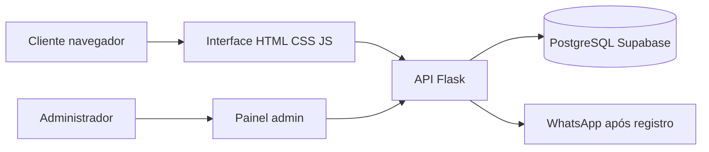
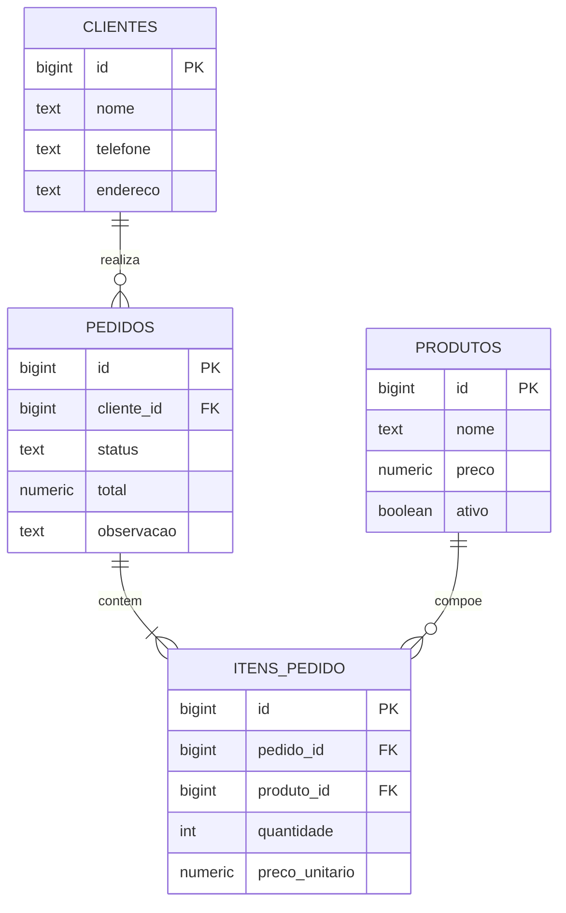

# Diagramas da solução

## Arquitetura

## Modelo de dados

## Padrão de organização
A aplicação utiliza separação entre interface (HTML/CSS/JS), rotas e regras (Flask) e persistência (PostgreSQL). **Não é MVC formalmente separado em módulos**; pode ser refatorada futuramente.
